# station-archive

Build one reconciled daily station-observation archive out of several
overlapping public climate sources — ECA&D, GHCN-Daily, NOAA GSOD and the
Copernicus C3S land collection — so that every accepted value has a single
physical-station identity, one chosen source, a recorded reason for that choice,
and a full trail back to the provider record it came from.

Concatenating these sources naively does not work. They redeliver each other,
disagree about where a station is, disagree about what a reported zero means,
and carry undocumented sentinels. This package treats all of that as the problem
to be solved rather than noise to be averaged away.

---

## What it does

**It downloads, standardises and consolidates station observations — then stops
and asks you about the cases it could not settle, and reruns honouring your
answers.** That human step in the middle is the shape of the whole tool:

```
   4 public sources
   ECA&D  GHCN-D  GSOD  C3S
            |
            |  discover  ->  coverage report     (read before downloading)
            |  fetch     ->  raw provider bytes, untouched
            v
        identity  ------------->  pairs the rules could not settle,
            ^                     plus every merge they made unasked
            |                             |
            |                             v
            |                     review/station_merge_review.xlsx
            |                     you write DECISION_merge = yes / no
            |                             |
            +-----------------------------+
              identity --decisions  (rerun, honouring your answers)
            |
            v
       consolidate  ->  one value per station / day / variable, with the
            |           reason it won and every loser kept for audit
            v
       homogeneity  ->  flags only. dem -> elevation only. No value altered.
```

1. **`discover`** asks each source what it holds in your domain and writes a
   coverage report. Nothing is downloaded yet — you read the report first.
2. **`fetch`** downloads the provider files, checksummed and restartable, and
   stores them **untouched** in their own units and formats.
3. **`identity`** works out which records from different sources are the same
   physical station, using identifiers, coordinates, elevation and how closely
   the daily series actually agree.
4. **`review`** is the human step. Every pair the rules could not settle — and
   every merge the rules made on their own authority — goes into a spreadsheet
   with the evidence beside it. You write `yes` or `no`.
5. **`identity --decisions`** reruns the crosswalk, now honouring your answers.
   A rerun never loses a decision you already made.
6. **`consolidate`** picks one value per station, day and variable, and records
   why that value won.
7. **`homogeneity`** flags series that appear to contain an artificial jump, and
   **`dem`** settles elevation disagreements against an independent elevation
   model. Neither changes an observation.

### The rules that merge two records into one station

A false merge is the damaging error — it fuses two different sites and puts one
station's observations into the other's series — so an automatic merge has to
clear every gate below, not a weighted score. Defaults shown; all of them live in
`policy.py` and are per-variable or per-unit.

**Tier 1 — an exact shared identifier.** A GHCN-D identifier (which C3S
redelivers verbatim) or a WMO number. Accepted on the identifier plus a distance
check only: no elevation test, no series test. The distance check exists because
identifiers are not always sound — 18 GSOD stations carried a WMO number
belonging to someone else, which merged sites 327 km apart.

**Tiers 2 and 3 — earned on evidence.** Every one of these must pass:

| Gate | Threshold | Why |
|---|---|---|
| Distance | ≤ 3.00 km (tier 2 if ≤ 0.22 km) | Archives disagree about one station's position by over a kilometre, so distance alone cannot separate a duplicate from a neighbour |
| Shared days | ≥ 1 in any variable | **Absolute.** No shared day means no evidence; such a pair can never be merged, not even by a reviewer |
| Elevation | within 50 m | Two reports of one station rarely differ by more than tens of metres |
| Overlap length | ≥ 365 shared days | Five shared days can reach r = 0.99 by chance |
| Correlation | ≥ 0.995 on `tasmax`, else `tasmin`, else `pr` | The first-choice variable is the best-populated one common to all three series sources |
| Mean absolute difference | ≤ 0.5 °C · 0.5 mm · 0.5 m s⁻¹ · 3 % | **The gate that actually discriminates** — see below |

That last row is the one worth understanding. **Correlation measures covariation,
not agreement, and the two come apart.** Measured on this archive: two genuinely
distinct stations 2.4 km apart correlate at 0.9915 while differing by 1.3 °C
*every single day* — a real lapse-rate difference between real sites. True
duplicates cluster at a mean absolute difference of 0.000 °C. At ~1 km
separation, daily maximum temperature at two distinct stations still correlates
above 0.98, so correlation alone is a weak duplicate test and near-identity of
values is the strong one.

**One override, deliberately narrow.** If two records agree to within 0.05 °C on
over 99 % of at least 365 shared days, they are the same instrument reported
twice, and that outranks an elevation conflict — two archives published one
station 113 m apart in stated height while agreeing to the last decimal on all
7,670 days they shared. Merely *correlated* stations never qualify, so distinct
sites at different altitudes stay separate. The conflict is still recorded in
`metadata_conflicts.csv`; the elevation is never silently corrected.

### When a station is flagged for you instead

The rules refuse to guess. Four flags on `station_aliases.csv` say what they
could not settle, and the review workbook turns each into a row you can answer:

| Flag | Means | Workbook sheet |
|---|---|---|
| `duplicate_risk` | Something was close enough to test and a gate failed. **This may be the same physical station and the archive could not prove it either way** — a train/test split must keep the pair together | `Review` (pairs within 3 km, with the evidence and a recommendation) |
| `agreement_review` | The merge was **accepted** but the two records still differ by more than 1.0 °C · 2.0 mm · 1.0 m s⁻¹ · 5 % on average. The merge stands and is marked | `Already_merged` |
| `never_merge_no_overlap` | Zero shared days in any variable. Permanently unmergeable, and a reviewer cannot override it | `Never_merge_rule` (no decision column — nothing to decide) |
| `group_formed_transitively` | A merged into B and B into C, but A and C were never compared directly | flagged on the alias, not a sheet |

Two things about that workbook are easy to miss. It lists **every merge the rules
made on their own authority**, widest-separation first, so you can veto one by
writing `no` — a wrong merge is more consequential than a missed one. And pairs
beyond 3 km get their own sheet rather than being dropped, because a station
whose two archives disagree about its position by several kilometres is exactly
the case where distance is the least trustworthy evidence.

### The rules that pick a value

Consolidation is deliberately dull, and that is the point. For each station,
day and variable:

- **The highest-ranked source that has data wins.** Ranking is per variable, not
  global — it was set by measuring coverage and reading each provider's own
  documentation about what its numbers mean, not by assuming one portal is best.
- **A day the winner lacks may be filled from a lower-priority record of the
  same physical station** — never from a different station.
- **A gap is only filled if the two records pass a compatibility test** on their
  overlapping days: bias, spread, wet-day frequency, and whether the
  disagreement is stable over time. If it fails, **the gap stays open.**
- **Nothing is ever invented.** No interpolation, no averaging of two sources, no
  bias correction, no averaging of coordinates. A day with no acceptable value
  simply has no row.
- **Nothing is silently dropped.** Every value that lost, and every gap left
  open, is written to an audit table with the reason.
- **Problems are diagnosed, not corrected.** A suspected artificial jump or a
  metadata conflict is flagged and left for you; the values stay exactly as the
  provider issued them.

**Measured on the real archive** (eastern Mediterranean, 1985–2005): 1,944
source station records became 1,546 canonical stations and 9,503,860 accepted
daily values, with 240,704 values rejected as non-observations, 246,989 values
excluded by a reviewer after the climatology screen (78 record x variable
series), 146 source switches refused as incompatible, 3,408,503 non-selected
candidate values retained for audit, and 478 series flagged as containing a
suspected artificial breakpoint.

This file is what you need to install the package, run it, and understand what
comes out. **`AGENTS.md` is the detailed companion**: every threshold with the
measurement behind it, the full output schema field by field, how each decision
is actually made, and the seven invariants the tests enforce.

---

## Contents

- [What it does](#what-it-does)
- [The pipeline](#the-pipeline)
- [Stage by stage](#stage-by-stage)
- [Install](#install)
- [Use](#use)
- [What comes out](#what-comes-out)
- [Sources](#sources)
- [Tests](#tests)
- [What this repository does not do](#what-this-repository-does-not-do)
- [Data licensing](#data-licensing)

---

## The pipeline

```mermaid
flowchart TD
    subgraph DISCOVER["1 · Discovery — before anything is downloaded"]
        A1["ECA&D"] --> INV["Per-source inventory<br/>one row per station-variable"]
        A2["GHCN-Daily"] --> INV
        A3["NOAA GSOD"] --> INV
        A4["Copernicus C3S"] --> INV
        INV --> REP["coverage_report.md<br/>stations, variables, gaps, licences"]
    end

    REP --> PLAN

    subgraph ACQUIRE["2 · Acquisition — bronze layer"]
        PLAN["plan: inventory to download requests"] --> MAN["request manifest<br/>written BEFORE transfer"]
        MAN --> FETCH["fetch: checksummed, restartable<br/>part file, renamed on success"]
        FETCH --> RAW[("raw/ — provider bytes,<br/>untouched, in provider units")]
        RAW --> SNAP["snapshot manifest<br/>sha256 per file"]
    end

    SNAP --> IDENT

    subgraph IDENTITY["3 · Identity — who is who"]
        IDENT["candidate pairs<br/>grid-blocked by coordinates"] --> LADDER{"matching ladder"}
        LADDER -->|tier 1| T1["exact identifier<br/>GHCN-D ID or WMO number"]
        LADDER -->|tier 2/3| T23["coordinates + elevation<br/>+ daily-series agreement"]
        LADDER -->|tier 4| T4["unresolved:<br/>stays separate, duplicate_risk"]
        T1 --> UF["union-find grouping"]
        T23 --> UF
        UF --> XWALK[("canonical/ — aliases, metadata<br/>history, evidence, conflicts")]
        T4 --> WB["review/station_merge_review.xlsx<br/>human adjudication"]
        WB -.->|"DECISION_merge yes/no"| LADDER
    end

    XWALK --> SREAD

    subgraph SILVER["4 · Standardise + QC — silver layer"]
        SREAD["read bronze series"] --> UNITS["unit conversion<br/>tenths / degF / inch / knot / K to canonical"]
        UNITS --> QCFLAG["flag QC: GSOD pr flags I and H,<br/>negative pr and wind"]
        QCFLAG --> QCRANGE["gross-range QC in canonical units<br/>catches undocumented sentinels"]
    end

    QCRANGE --> CONS

    subgraph GOLD["5 · Consolidation — gold layer"]
        CONS{"per station x date x variable"} --> P["highest-ranked source<br/>with data = primary"]
        P --> GAP{"days the primary lacks?"}
        GAP -->|no| OUT
        GAP -->|yes| COMPAT{"compatibility test:<br/>bias, dispersion,<br/>wet-day freq, monthly step"}
        COMPAT -->|pass| FILL["fill gap, is_fallback = true"] --> OUT
        COMPAT -->|fail| LEAVE["leave the gap OPEN<br/>never splice, never interpolate"]
        LEAVE --> AUDIT[("non_selected_candidates/<br/>every value not chosen")]
        OUT[("observations_consolidated/<br/>value + source + rank + reason")]
    end

    OUT --> HOMOG

    subgraph DIAG["6 · Homogeneity — diagnose, never correct"]
        HOMOG["monthly anomalies vs<br/>nearest passing neighbours"] --> SNHT["SNHT + permutation p-value<br/>+ SNHT floor of 20 + two neighbours minimum"]
        SNHT --> FDR["Benjamini-Hochberg<br/>across the whole report"]
        FDR --> FLAGS[("homogeneity_flags.csv<br/>flag layer, no value changed")]
    end

    OUT --> READ
    FLAGS --> READ

    subgraph SERVE["7 · Read-back — IN THE CONSUMING PROJECT, not here"]
        OVR["review/elevation_overrides.csv<br/>applied at read time, never written back"] --> READ
        READ["pivot to wide station-day table<br/>+ join canonical metadata + flags"] --> FOLDS["fold design:<br/>must keep duplicate_risk<br/>pairs on one side"]
    end
```



The ordering is enforced, not conventional: `fetch` plans from an inventory
that `discover` already wrote, `identity` needs the inventories, `consolidate`
needs the crosswalk, and `homogeneity` needs the gold table. Each command
refuses to run and names its missing predecessor.

---

## Stage by stage

| Stage | Module | What it decides |
|---|---|---|
| Policy | `policy.py` | Every scientific threshold, the domain and the window — one immutable value, passed explicitly |
| Settings | `settings.py` | Where the archive lives and how transfers behave. Nothing scientific |
| Sources | `sources/registry.py` | Which sources exist, and what each is allowed to do |
| Discovery | `inventory.py`, `sources/*` | What each source offers in a domain and period, **before** anything is bulk-downloaded |
| Acquisition | `bronze.py`, `net.py`, `manifests.py`, `ziprange.py` | Restartable, checksummed, idempotent downloads; provider bytes stored untouched |
| Identity | `identity.py`, `review.py` | Which source records are the same physical station |
| Standardisation | `standardize.py` | Units, and the single named place a documented day-window correction could live |
| Quality control | `qc.py` | Which values are not observations |
| Consolidation | `consolidate.py` | Which value wins per station/date/variable, and why |
| Homogeneity | `homogeneity.py` | Which series contain artificial breakpoints |
| Elevation | `dem.py` | Which of two disagreeing archive elevations is right, against an independent DEM |
| Provenance | `manifests.py` | What built this archive: policy, releases, checksums |
| Demo | `demo.py` | The whole chain on synthetic provider files, with no network |

Scientific policy — every threshold — lives in `policy.py`, separately from
`settings.py`, which holds paths, timeouts and disk limits. The split is what
lets a published archive state which policy produced it, and what stops a
machine setting being mistaken for a scientific one. `DEFAULT_POLICY` carries
exactly the values this archive was built with.

No adapter converts units, reconciles duplicates, ranks sources or fills gaps;
the only policy an adapter ever sees is the fetch-year window and, for API
sources, the request area. `AGENTS.md` states the seven invariants that hold
this together, each of which is tested.

---

## Install

```bash
pip install -e .
export ARCHIVE_ROOT_ENV_VAR=/path/with/several/GB/free   # not your checkout
```

Installing gives you a `station-archive` command equivalent to
`python -m station_archive.cli`. `pyproject.toml` is the single declaration of
what this package needs; `pip install -e ".[dev]"` adds the test and C3S extras.
Python >= 3.10.

Then, before anything else:

```bash
station-archive demo                # the whole chain on synthetic data, ~10 seconds
```

No network, no credentials, nothing downloaded. It writes synthetic files in the
providers' own formats and runs the real adapters, the real crosswalk and the
real consolidator over them, planting a true duplicate, a fillable gap and a
step change so each decision is visible being made. **Start here** — it is the
cheapest accurate picture of what the pipeline does.

`ARCHIVE_ROOT_ENV_VAR` matters more than it looks: the archive is several GB of
provider data under redistribution restrictions, and the ignore rules exist to
keep it out of git. Point it somewhere outside your checkout. Unset, it defaults
to `~/station_archive`.

`cdsapi` is only needed for the Copernicus C3S source; it reads `~/.cdsapirc` or
`CDSAPI_URL` / `CDSAPI_KEY`. No credentials belong in this repository.

---

## Use

The stages run in order, and the order is enforced rather than remembered: each
command refuses to run and names its missing predecessor.

```bash
station-archive status                        # where the archive lives, and space
station-archive discover --sources ghcnd ecad gsod
station-archive report                        # read this before downloading
station-archive fetch --sources ghcnd         # restartable, checksummed
station-archive identity                      # canonical station crosswalk
station-archive review                        # workbook for unresolved pairs
station-archive identity --decisions review/station_merge_review.xlsx
station-archive consolidate                   # the gold table
station-archive dem                           # settle elevation disagreements
station-archive homogeneity                   # breakpoint diagnosis
station-archive provenance                    # what built this archive
```

Once the archive exists, the quality-control loop is two commands around one
sitting with the review workbook:

```bash
station-archive prepare --reference derived/step2_cache/cerra_stations_expanded.parquet \
    --reference-static derived/step2_cache/geo_stations_expanded.parquet
#   identity (with decisions already made) -> climatology screen -> review workbook
#   ... answer DECISION_merge and DECISION_exclude in review/station_merge_review.xlsx ...
station-archive apply
#   identity --decisions -> dem -> consolidate --decisions -> homogeneity -> provenance
```

Merges and series exclusions are answered at the same sitting because neither
depends on the other: the climatology screen judges each source record, not
the merged station, and an exclusion never changes the evidence a merge rests
on. Elevation asks nothing — the rule keeps the coordinates of the record with
the most observations and the published elevation nearest the DEM — and runs
after the merges, because a merge changes the candidates. Breakpoints come last
because they can only be found on the final series; they are flags, listed in
`consolidated/homogeneity_breakpoints.xlsx`, and change no value.

Discovery comes before acquisition on purpose: there is no path that
bulk-downloads without writing a coverage record first.

Useful flags: `fetch --dry-run` prints the transfer plan without moving bytes,
`fetch --limit N` and `consolidate --limit N` bound a trial run, and
`homogeneity --variables tas pr --permutations 500 --alpha 0.05` narrows the
diagnosis.

Two stages stop and ask a person. `review` builds a spreadsheet of the station
pairs the rules could not resolve; you fill in `DECISION_merge` with `yes` or
`no` and feed it back with `identity --decisions`. The same workbook's `Series`
sheet lists the source records whose long-term mean sits implausibly far from
an independent reference (`climatology`); a `yes` in `DECISION_exclude` takes
that record out of selection in `consolidate --decisions`, and the next-ranked
source takes over. A blank keeps the record. `dem` settles elevation
disagreements against an independent digital elevation model and writes
`review/elevation_overrides.csv`. Both are inputs: the pipeline rebuilds them,
but a rebuild carries forward every decision already made and every override
written by hand.

### Running it on your own region

The domain, the admission window, the fetch window and the variable set are
arguments, not source edits:

```bash
station-archive discover --domain 36 44 -10 4 --buffer 2 --period 1990 2010
station-archive consolidate --policy iberia.json
```

A policy file is an override list, so a region change is three lines and
everything it omits is inherited from the default and recorded as such:

```json
{
  "domain": {"lat_min": 36.0, "lat_max": 44.0,
             "lon_min": -10.0, "lon_max": 4.0, "buffer_deg": 2.0},
  "period": [1990, 2010]
}
```

`station-archive provenance --policy-out policy.json` writes back the policy
actually in force, so a published archive can carry the exact configuration that
produced it.

---

## What comes out

The archive lives under `STATION_ARCHIVE_ROOT`, outside the checkout:

```
<STATION_ARCHIVE_ROOT>/
    raw/<source>/<release>/...              immutable provider bytes (bronze)
    manifests/source_releases.jsonl         source, version, time, licence
    manifests/<source>/<release>/requests.jsonl
    manifests/<source>/<release>/snapshots.jsonl
    manifests/provenance.json               policy, releases, checksums
    inventory/<source>_inventory.csv
    inventory/coverage_report.md
    canonical/                              the identity crosswalk
    consolidated/                           the gold table and its audits
    review/                                 human decisions (INPUTS)
```

Those layer names are a common data-engineering convention. **Bronze** is
provider bytes exactly as downloaded, in the provider's own units, never
modified. **Silver** is those values converted to canonical units with quality
control applied. **Gold** is the finished table. Silver is a pass in memory
rather than a directory — converting 9.7 million values to disk only to read
them straight back would double the storage for a layer nothing queries.

### The main output

`consolidated/observations_consolidated/` is the gold table: partitioned
parquet, one row per accepted `canonical_station_id × date × variable`. Read the
parts together; the split is a memory bound, not a grouping.

| Column | Meaning |
|---|---|
| `canonical_station_id` | The physical station, e.g. `ecad:000247` |
| `date`, `variable` | The observation day, and a CMIP/CORDEX short name (`tas`, `tasmin`, `tasmax`, `pr`, `hurs`, `sfcWind`, `gust`) |
| `value`, `units` | The accepted value, in canonical units |
| `selected_source`, `source_rank` | Which provider supplied it, and its priority position |
| `source_station_id` | That provider's own identifier for the station |
| `selection_reason` | Why this value won, in words |
| `is_fallback` | True when a lower-priority alias filled a day the primary lacked |
| `source_record_id` | `source:station:date:variable` — traceable to the bronze snapshot |

Four conventions worth knowing before you read it:

- **Canonical units throughout** — `degC`, `mm`, `percent`, `m s-1` — and `units`
  states it on every row.
- **A missing day has no row.** There is no NaN placeholder: absence means no
  candidate passed quality control, and the reason is in the audit tables below.
  Nothing is ever interpolated.
- **An alias key is `source:source_station_id`.** A `canonical_station_id` is the
  lexicographically smallest alias key in its group, so it looks like one
  source's key but names the physical station, not that source's record.
- **`duplicate_risk` is the column a modelling consumer must not ignore.** On an
  alias it means "this may be the same physical station as another and the
  archive could not prove it either way". A train/test split has to keep such a
  pair on the same side or it leaks.

### The other tables

| File | What it is |
|---|---|
| `consolidated/non_selected_candidates/` | Every candidate value that existed but was not chosen, with why |
| `consolidated/fallback_compatibility.csv` | Every source switch considered, its four test statistics, and whether it was allowed |
| `consolidated/qc_rejections.csv` | Rejected values by source, variable and reason |
| `consolidated/source_contribution.csv` | Selected days by variable, year, source and fallback status |
| `consolidated/homogeneity_breakpoints.csv` | The full breakpoint report, including series that could not be tested and why |
| `consolidated/homogeneity_flags.csv` | The flag layer: FDR-surviving rows only, shaped to join onto the gold table |
| `consolidated/homogeneity_breakpoints.xlsx` | The same flags for a person: every surviving break with station name, position, date and shift |
| `consolidated/climatology_screen.csv` | Every selectable source record x variable against the reference: departure, robust z, tier, reporting fraction, neighbour context |
| `canonical/station_aliases.csv` | Every source station, its canonical ID, the tier and evidence that put it there, and its risk flags |
| `canonical/canonical_stations.csv` | One authoritative coordinate, elevation and name per canonical station, with the contest that decided it |
| `canonical/station_metadata_history.csv` | Each alias's own coordinates as a time-bounded segment — a moved station is two segments, never an average |
| `canonical/duplicate_evidence.csv` | Every pair tested, accepted or not, with distance, elevation gap, correlation, bias, mean absolute difference and a reason |
| `canonical/metadata_conflicts.csv` | Pairs whose observations prove one instrument but whose archives publish irreconcilable coordinates or elevation |
| `inventory/coverage_report.md` | What each source offers in the domain, before anything is downloaded |
| `manifests/provenance.json` | What built this archive: the policy in force, each provider release and checksum, library versions |
| `review/station_merge_review.xlsx` | **Input.** Merge decisions for pairs the rules could not resolve, and series exclusions (`Series` sheet) |
| `review/elevation_overrides.csv` | **Input.** Reviewed elevation corrections, applied at read time with the evidence for each |

**Every column of every one of these is documented field by field in `AGENTS.md`
under *Reference: output schema*.**

---

## Sources

| Source | Access | Domain footprint | Licence |
|---|---|---|---|
| `ghcnd` | per-station `by_station/<ID>.csv.gz` | ~260 kB/station | NOAA open data |
| `ecad` | ranged reads into `ECA_blend_<elem>.zip` | a few kB/station-element | **Non-commercial research and education only** |
| `gsod` | per-station-year CSV | ~80 kB/station-year | NOAA open data |
| `c3s_land` | Copernicus CDS API | one request per year | Copernicus / CC-BY-4.0 |

`c3s_land` is deliberately never selected as a value source. In this domain every
one of its stations carries an exact GHCN-D identifier, making it a redelivery
rather than independent evidence, so it joins the crosswalk as an audit
cross-check only. `AGENTS.md` covers the per-source quirks that shaped the
adapters — the 5.4 GB ECA&D problem, C3S variable coverage, and why GSOD ranks
last for precipitation despite having the most stations.

---

## Tests

```bash
python -m pytest tests/ -q
```

440 tests, a few seconds, no network. The suite is part of the repository on
purpose: for a published pipeline it is the executable statement of the archive's
rules, not developer scaffolding. `test_standardize.py` is what keeps the
withdrawn bias correction withdrawn; `test_consolidate.py` is the only artefact
proving gaps are left open rather than spliced; `test_policy.py` pins the
thresholds that produced the published archive.

Fixtures in `tests/fixtures.py` are verbatim excerpts of real provider responses
captured 13 September 2026, so a provider format change fails a test against the
format the adapter was written for. A test that needs a socket is a bug in the
test.

---

## What this repository does not do

It builds the archive. It does not model anything with it.

That boundary is deliberate and was learned the hard way: cross-validation fold
design used to live here, and the question "why this many folds?" turned out to
be unanswerable from inside an archive. The right block size depends on how far
from a station a model will actually be asked to predict — a property of the
experiment, not of the observations. So fold construction, the fold count, the
station-day read schema and the decision of which stations to score all live in
the consuming project, which owns those questions.

What the archive owes a consumer, and provides:

| The archive tells you | Where |
|---|---|
| The value, its source, its rank and the reason it won | `consolidated/observations_consolidated/` |
| What else could have been chosen | `consolidated/non_selected_candidates/` |
| Which source records are one physical station | `canonical/station_aliases.csv` |
| **Which duplicates it could not resolve** — do not let a split separate these | `canonical/duplicate_evidence.csv`, `duplicate_risk` |
| Where two archives disagree about a station, and which won | `canonical/metadata_conflicts.csv` |
| Which series contain a suspected artificial breakpoint | `consolidated/homogeneity_flags.csv` |
| Which elevations were corrected, and on what evidence | `review/elevation_overrides.csv` |
| What built all of it | `manifests/provenance.json` |

The fourth row is the one a modelling project must not ignore: a station the
archive could not resolve may be the same physical site as another, and putting
the two on opposite sides of a train/test split leaks. The archive states the
risk; deciding what to do about it belongs to whoever builds the split.

---

## Data licensing

**This repository contains code only.** It redistributes no observations, and the
archive it builds must not be committed. Provider terms apply to anything you
download — notably **ECA&D public station data is non-commercial research and
education only**, and some contributing ECA&D series are not downloadable at all
(those are recorded as `restricted_or_absent` rather than silently dropped). See
`LICENSE` for the full per-source list.

---

## Repository layout

| Path | What it is |
|---|---|
| `station_archive/` | The package |
| `tests/` | The suite; also the executable specification |
| `AGENTS.md` | Everything this file leaves out: the invariants, every threshold with its measurement, the full output schema, and how each decision is made |
| `CITATION.cff` | How to cite the code, and the archive built with it |
| `pyproject.toml` | Installable package, dependencies, and the `station-archive` entry point |
| `.github/workflows/tests.yml` | CI on Linux and Windows, Python 3.10–3.12 |
| `LICENSE` | MIT, for the code. Provider data carries its own terms — see Data licensing |

Two documents, deliberately: this one to install and run the pipeline,
`AGENTS.md` for the full detail. Version history lives in the GitHub releases and
the commit log rather than in a file.
